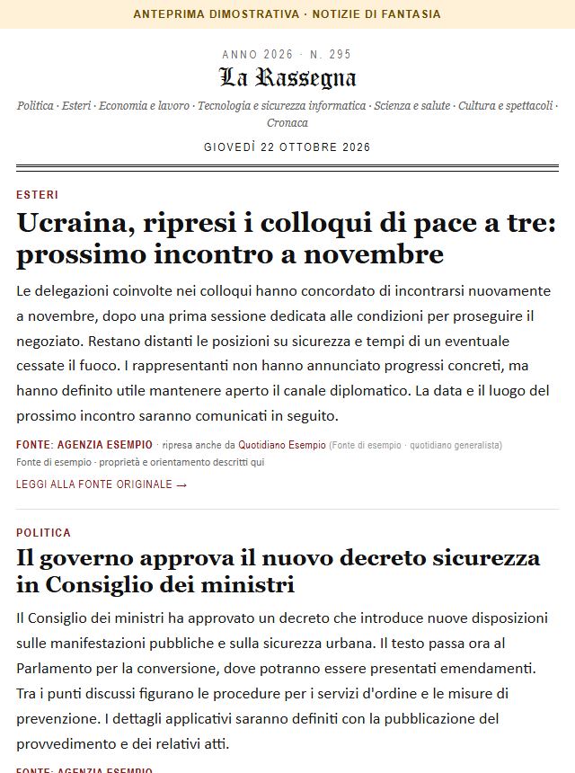

# Personal Digest Mail

[](https://github.com/zenobor/rassegna/actions/workflows/tests.yml)

Your own newspaper-style email, built from public RSS feeds. Fork this project, choose
your topics and schedule, add email credentials, and GitHub Actions sends your digest.

Articles include the title and the full summary supplied in the publisher's RSS feed,
with no character limit. Stories without a useful RSS summary are left out. The app does
not copy full article pages or bypass paywalls, so detail depends on what each publisher
includes in its feed.

<p align="center"></p>

## Set it up

1. Fork this repository on GitHub, then clone your fork:
   ```powershell
   git clone https://github.com/YOUR-USERNAME/rassegna.git
   cd rassegna
   ```
2. Install Python 3.12+ and configure your edition (language, topics, time zone, days, and time):
   ```powershell
   py -m venv .venv
   .\.venv\Scripts\python.exe -m pip install -r requirements.txt
   .\.venv\Scripts\python.exe rassegna.py --configura
   ```
3. Push your settings to your fork:
```powershell
git add preferenze.yaml .github/workflows/rassegna.yml
git commit -m "Set up my digest"
git push
```
4. In **Settings → Secrets and variables → Actions**, add `SMTP_USER`, `SMTP_PASSWORD`,
   `MAIL_TO`, and `DEEPL_API_KEY`. Gmail requires a [Google App Password](https://myaccount.google.com/apppasswords).
   Get a DeepL API key from DeepL; translation may be subject to its usage limits or charges.
   For other email providers, also set `SMTP_HOST` and `SMTP_PORT`. Never commit credentials.

Then open **Actions → Personal Digest Mail → Run workflow** to test delivery.
Automatic emails follow the schedule you selected. GitHub Actions may run a little late.

## Preview and tests

Neither preview command sends email:
```powershell
# Offline sample with fictional stories
.\.venv\Scripts\python.exe rassegna.py --demo --anteprima anteprima-demo.html

# Live RSS preview
.\.venv\Scripts\python.exe rassegna.py --anteprima
```
The live preview may send foreign-language RSS summaries to DeepL and use your API quota.
Run the tests with:
```powershell
.\.venv\Scripts\python.exe -m unittest discover -s tests -v
```

GitHub also runs these tests automatically on every push and pull request.

## Customize and troubleshoot

- `preferenze.yaml`: topics and delivery schedule. Matching uses article titles and RSS summaries.
- During setup, choose an article language using an ISO code (`it`, `en`, `fr`, etc.) or `tutte`.
  Articles already in that language stay as published; foreign-language RSS titles and
  summaries are translated with DeepL before topic matching. `tutte` leaves articles
  untranslated. Add `DEEPL_API_KEY` to your local `.env` and GitHub Secrets. Foreign
  feed text is sent to DeepL and may use your API quota.
- `config.yaml`: RSS sources, their language, sections, article limits, and look-back period.
- If a feed does not identify a language, its articles are kept rather than silently discarded.
- `templates/`: email design.
- A feed without a usable summary is skipped; unavailable feeds are reported in the Actions log.
- If no stories match, broaden your keywords or add RSS sources.
- If no email arrives, check the Actions log, spam folder, and SMTP secrets.

## License

MIT © 2026 Zeno Borgnino. RSS excerpts and linked content remain subject to each publisher's terms.
